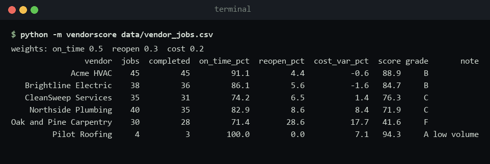

# vendor-scorecard

A command-line tool that reads a job history CSV and gives each vendor one score from 0 to 100 and a letter grade.



## What it is for

Facility teams hire several vendors for the same trades and rarely measure them side by side. Questions like "who finishes on time", "whose work comes back", and "who bills over the estimate" sit in separate reports, so contract renewals are decided on memory. Facility managers, maintenance planners and procurement staff get one score per vendor, built from three visible rates: on-time completion, reopened jobs and cost against the estimate. The sample data is synthetic.

## Install

```
git clone <this repository> && cd vendor-scorecard
python -m pip install -r requirements.txt
python -m pip install -e .
```

## How to use

| I want to | Command |
|---|---|
| Score every vendor in a job history CSV | `python -m vendorscore data/vendor_jobs.csv` |
| Change the weights for on time, reopen and cost (fractions that must add up to 1, default 0.5,0.3,0.2) | `python -m vendorscore data/vendor_jobs.csv --weights 0.4,0.4,0.2` |
| Change the completed jobs needed for a firm score (vendors below it are marked `low volume`) | `python -m vendorscore data/vendor_jobs.csv --min-jobs 10` |

Worked example:

```
python -m vendorscore data/vendor_jobs.csv
```

Output:

```
weights: on_time 0.5  reopen 0.3  cost 0.2
                vendor  jobs  completed  on_time_pct  reopen_pct  cost_var_pct  score grade       note
             Acme HVAC    45         45         91.1         4.4          -0.6   88.9     B           
   Brightline Electric    38         36         86.1         5.6          -1.6   84.7     B           
   CleanSweep Services    35         31         74.2         6.5           1.4   76.3     C           
    Northside Plumbing    40         35         82.9         8.6           8.4   71.9     C           
Oak and Pine Carpentry    30         28         71.4        28.6          17.7   41.6     F           
         Pilot Roofing     4          3        100.0         0.0           7.1   94.3     A low volume
```

## How it works

- Only completed jobs count. A job is on time when the completed date is on or before the due date.
- Reopen rate is the share of completed jobs marked `reopened = yes`.
- Cost variance is total actual cost minus total estimate, divided by total estimate. Cost over the estimate is penalised. Cost under the estimate cannot score above 100.
- Component scores: on time is its percentage. Reopen is 100 at 0 percent and falls to 0 at 20 percent. Cost is 100 at or under the estimate and falls to 0 at 25 percent over.
- The final score is the weighted sum (default 50, 30 and 20 percent), rounded to one decimal. Grades: A 90 and up, B 80, C 70, D 60, F below.
- A vendor with fewer completed jobs than `--min-jobs` is marked `low volume` and listed last, so three good jobs do not outrank a long record.

## Limits

- The caps (20 percent reopen, 25 percent cost) and the grade lines are fixed choices in `scorecard.py`. They are not tuned to any real contract.
- Cost variance uses totals, so one large job weighs more than many small ones.
- No time trend. All rows are scored as one period.
- Quality, safety and response time are not measured.

## License

MIT. Yassine Emhamed, 2026.
